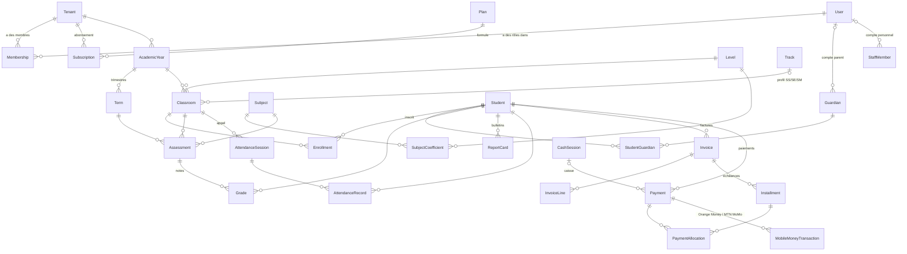

# Modèle de données multi-écoles

Source de vérité : [`apps/api/prisma/schema.prisma`](../apps/api/prisma/schema.prisma)
(44 tables, 20 énumérations, 97 clés étrangères).

## Les 8 règles du modèle

| # | Règle | Pourquoi |
|---|-------|----------|
| 1 | Toute table d'école porte `tenantId` | Chaque ligne appartient à un seul établissement |
| 2 | Row-Level Security PostgreSQL sur toutes ces tables | La base refuse les lignes d'une autre école, même si le code oublie un filtre |
| 3 | Relations obligatoires en clé étrangère **composite** `(tenantId, xxxId) → (tenantId, id)` | Une note de l'école A ne peut physiquement pas pointer vers un élève de l'école B |
| 4 | Comptes globaux, données scolaires par école | Un parent a **un seul compte** pour ses enfants dans plusieurs écoles |
| 5 | Montants en **entiers GNF** (`Int`), jamais de `Float` | Pas d'erreur d'arrondi sur l'argent |
| 6 | Identifiants **UUID** | Le téléphone peut créer une note ou un appel hors-ligne sans conflit |
| 7 | Notes et paiements ne s'effacent jamais | Annulation motivée + journal d'audit en ajout seul |
| 8 | Reçus numérotés par une séquence **par école**, sans trou | Contrôle de caisse et anti-détournement |

Les règles 1, 3 et 5 sont vérifiées automatiquement par `scripts/check_schema.py` ;
les règles 2, 7 et 8 par `apps/api/prisma/sql/security.test.sql` sur un vrai PostgreSQL.

## Vue d'ensemble

## Tables par domaine

| Domaine | Tables |
|---------|--------|
| Comptes (globales) | `User`, `UserSession`, `OtpCode` |
| Plateforme | `Tenant`, `Plan`, `Subscription`, `SupportAccessGrant`, `Membership` |
| Structure pédagogique | `Campus`, `AcademicYear`, `Term`, `Level`, `Track`, `Classroom`, `Room`, `Subject`, `SubjectCoefficient`, `GradingPolicy` |
| Personnes | `StaffMember`, `TeachingAssignment`, `Student`, `Guardian`, `StudentGuardian`, `Enrollment` |
| Notes | `Assessment`, `Grade`, `ReportCard` |
| Présences, emplois du temps | `AttendanceSession`, `AttendanceRecord`, `TimetableEntry` |
| Finances | `FeeType`, `FeeRate`, `Invoice`, `InvoiceLine`, `Installment`, `CashSession`, `ReceiptCounter`, `Payment`, `PaymentAllocation`, `MobileMoneyTransaction` |
| Communication | `Announcement`, `SmsMessage` |
| Exploitation | `ImportJob`, `AuditLog` |

## Décisions de modélisation

**Un seul compte par personne.** `User` est identifié par le téléphone. Ses rôles
dans chaque école sont des lignes `Membership` (un tableau de rôles, car un
enseignant peut aussi être parent). Le parent d'enfants scolarisés dans deux
écoles voit ses deux écoles à la connexion, puis choisit laquelle ouvrir.

**Transfert d'élève.** Aucune école ne lit les données d'une autre. L'école
d'origine exporte un dossier de transfert ; l'école d'accueil l'importe avec
l'accord du parent (prévu en phase 4).

**Hors-ligne.** `Grade` et `AttendanceSession` ont des identifiants créés sur le
téléphone. Une saisie renvoyée deux fois tombe sur la même clé et n'est
enregistrée qu'une fois. `Grade.clientUpdatedAt` permet de résoudre les
conflits (la plus récente gagne, l'autre reste dans l'historique d'audit).

**Paiement Mobile Money.** `Payment` est créé `EN_ATTENTE` ; il ne passe
`CONFIRME` (et ne reçoit son numéro de reçu) qu'après la confirmation de
l'opérateur, enregistrée dans `MobileMoneyTransaction`.
`@@unique([provider, providerTxId])` empêche qu'une notification reçue deux fois
crée deux paiements ; `Payment.idempotencyKey` fait de même côté application.

**Barèmes.** `Level.gradeScale` (10 ou 20) et `GradingPolicy` (poids par type
d'évaluation, absences, mentions, moyenne annuelle) rendent le calcul
paramétrable par école et par niveau. Le calcul lui-même est dans
`apps/api/src/domain/grades.ts`, couvert par des tests.

## Points ouverts

- Les contraintes uniques qui incluent une colonne facultative
  (`SubjectCoefficient` avec `trackId`, `GradingPolicy` avec `levelId`)
  acceptent plusieurs lignes `NULL` en PostgreSQL. L'API doit empêcher ces
  doublons ; une migration `NULLS NOT DISTINCT` pourra être ajoutée.
- Les tables des modules V2 (bibliothèque, cantine, transport, internat, LMD)
  ne sont pas encore modélisées, conformément au périmètre MVP.
